# transit-braid

[](https://www.npmjs.com/package/transit-braid)
[](LICENSE)
[](https://github.com/shakedk/transit-braid/actions/workflows/ci.yml)
[](https://scorecard.dev/viewer/?uri=github.com/shakedk/transit-braid)

**[Live demo](https://shakedk.github.io/transit-braid/)** ·
**[Examples](https://shakedk.github.io/transit-braid/examples.html)**: real bus routes and made-up
scenarios (loops, splits, one-way pairs, stops), each opening in the demo

Side-by-side transit lines for web maps. Give it overlapping bus, tram or rail routes as GeoJSON
lines; it returns GeoJSON with the routes drawn next to each other where they share a street, plus
station bars. It runs in the browser (Rust → WebAssembly in a Web Worker) and in Node 24+, and
computes geometry only, so any map library can draw the result.



```sh
npm install transit-braid
```

```ts
import { sideBySide } from 'transit-braid';

const out = await sideBySide(routes, { zoom: 13, lineWidth: 4, spacing: 1 });
// out.lines    → GeoJSON lines, one per input route
// out.stations → GeoJSON station bars
```

> **Status:** version 0.1.1. The API here works as shown;
> [CHANGELOG.md](CHANGELOG.md) lists what each version does, its limits and its errors. Full
> documentation comes later.

## Which one do I use?

| Your setup                                                  | Import                 | Why                                                                                                                                                                                                                                         |
| ----------------------------------------------------------- | ---------------------- | ------------------------------------------------------------------------------------------------------------------------------------------------------------------------------------------------------------------------------------------- |
| An app built with a bundler (Vite, webpack)                 | `transit-braid`        | Runs in a background worker, so the page never freezes. Your bundler copies the worker and the `.wasm` file into your build by itself: the code points at them with `new URL('./file', import.meta.url)`, a pattern Vite and webpack 5 know |
| A page without a bundler (a plain `<script type="module">`) | `transit-braid/inline` | One file with the worker and the WebAssembly inside, so there is no separate worker or `.wasm` to serve; a bigger download                                                                                                                  |
| Node 24+ (a server, a script, a build step)                 | `transit-braid/node`   | Node has no browser workers: it runs on your thread, or in a worker thread with `createBraidWorker()`                                                                                                                                       |

**Without a bundler,** copy `node_modules/transit-braid/dist/inline.js` next to your page and
import it from there:

```html
<script type="module">
  import { sideBySide } from './inline.js';

  const out = await sideBySide(routes, { zoom: 13 });
</script>
```

## Sessions, for editors

`sideBySide()` is pure: the same input always draws the same way, whatever ran before. Drawing the
same routes again at another zoom is fast (it reuses the last call's graph, with the same result
as a fresh call); any other change draws from scratch.

**What's a session?** An object a map editor keeps while the user edits routes. Each call through
it remembers the previous one, so after an edit only the changed part is computed again and the
other routes keep their lanes. `close()` frees its memory.

```ts
import { createSession } from 'transit-braid';

const session = createSession();
const out = await session.sideBySide(routes, { zoom: map.getZoom() });
// … again on every edit or zoom; when done:
session.close();
```

**How an edit is found.** A session compares each call's routes with the previous call's, by
their GeoJSON `id`: the same id with the same points is unchanged; anything else is changed,
added or removed. Only the streets near those routes are rebuilt, and the lanes' order starts from
the last one.

**Where the cache lives.** In memory only, inside the WebAssembly module (in the browser's worker,
or in Node). Nothing is saved to disk. After a page refresh, the first call draws from scratch:
still correct, but routes may sit in a different order than after your edits.

## Scale: `zoom` or `metersPerPixel`

Give exactly one. Line widths and gaps are in pixels, but the engine works in meters, so it needs
to know how many meters on the ground one screen pixel covers. `zoom` gives that for web maps: it
counts 512-pixel tiles, as MapLibre GL, Mapbox GL and deck.gl do; for a 256-pixel-tile map
(Leaflet, OpenLayers, Google Maps) pass its zoom − 1. `metersPerPixel` is for anything else, such
as a printed poster. In Tel Aviv at zoom 13, one pixel is about 8 m, so a 4 px line stands for a
32 m wide band on the ground.

## Stops


Pass stops as the `stations` option (GeoJSON Points, each with an optional `name`). Each gets a
bar across every line on its street there, not only the routes that stop. Transit feeds give each
side of a street its own stop id, so ids can't tell that two stops are a pair; their shared name
can: same-name stops within 50 m of each other on the same piece of street share one bar, at their
average place. The same name farther along the street keeps its own bar. A stop more than 25 m
from every route gets no bar.

## Will my data work?

One call draws a city or a metro area. Before you try, check:

- **Routes:** at most 70 LineString features, each one route in one direction. On the densest
  city we test, 70 routes take up to about 200 ms per edit in Chromium, and a first draw about
  a second.
- **Ids:** each route needs its own GeoJSON `id` (the feature's own field, a string or a number),
  or the call is refused as `MISSING_ID`. A file without ids can number its routes:
  `features.map((f, i) => ({ ...f, id: i }))`. In a session, keep each route's id the same from
  one edit to the next.
- **Area:** all routes within 200 km east-west and 200 km north-south. A long intercity rail line
  doesn't fit; commuter rail inside one metro area does.
- **Length:** at most 2,000 km of routes in all (a city's 70 busiest bus routes: about 1,400 km).
- **Points:** at most 1,000,000 in all (a city's 70 busiest routes: about 20,000).
- **Stops:** at most 5,000.
- **The date line:** no route may cross the 180° meridian in the Pacific (Fiji, the Aleutians).
- **Very dense data** (points piled up in one place, thousands of short crossing pieces) can still
  be refused as `TOO_COMPLEX`. Real cities stay far below that.

Anything over a limit is refused at once with its own error code, before any heavy work
([CHANGELOG.md](CHANGELOG.md) lists them all).

## deck.gl

[`transit-braid-deck`](packages/transit-braid-deck) is a second npm package, released together
with this one: a deck.gl 9 layer that draws with transit-braid.

```sh
npm install transit-braid-deck transit-braid @deck.gl/core @deck.gl/layers
```

```ts
import { BraidLayer } from 'transit-braid-deck';

new BraidLayer({ id: 'routes', data: routes, stations, lineWidth: 4, spacing: 1, pickable: true });
```

It keeps a session while it is on the map and draws again once the zoom settles. More in
[its README](packages/transit-braid-deck/README.md).

## Requests and future development

- **Long routes (intercity rail).** Today one call must fit in a 200 × 200 km box, because the
  engine draws on a flat map that stays accurate only near its center. A proposal: cut the
  network into overlapping windows of city size, draw each in its own flat map, and join the
  windows' lines where they overlap; or keep one call but correct the scale along each route.
  Either keeps every result the same on every machine. Ask for it in an issue if you need it.
- **More routes per call.** 70 is the most that keeps an edit under 200 ms on the densest city we
  test; faster station bars and ordering would let it grow.

Have a request? Open an issue.

## Developing

New here? [CONTRIBUTING.md](CONTRIBUTING.md) gets you running in five commands. Everything else
(commands, how each part is tested, releasing): [DEVELOPMENT.md](DEVELOPMENT.md).

## Credits

- **The research it builds on.** The line graph and the line-ordering model follow the published
  work of Hannah Bast, Patrick Brosi and Sabine Storandt:
  - "Efficient Generation of Geographically Accurate Transit Maps":
    [ACM SIGSPATIAL 2018](https://ad-publications.informatik.uni-freiburg.de/SIGSPATIAL_transitmaps_2018.pdf), and the extended version in ACM TSAS 2019
    ([arXiv:1710.02226](https://arxiv.org/abs/1710.02226));
  - Patrick Brosi's dissertation, ["Automated Generation of Transit Maps"](https://ad-research.cs.uni-freiburg.de/tmp/diss-patrick-brosi.pdf)
    (University of Freiburg, 2022);
  - Brosi and Bast, ["Large-Scale Generation of Transit Maps from OpenStreetMap Data"](https://ad-publications.cs.uni-freiburg.de/Large-Scale_Generation_of_Transit_Maps_from_OpenStreetMap_Data.pdf)
    (The Cartographic Journal, 2024).

  transit-braid builds on their research, uses none of LOOM's code, and makes changes of its own;
  where it differs, and why: [docs/design](docs/design/).

- **[LOOM](https://github.com/ad-freiburg/loom)**, the authors' own open-source tool for this research (GPL-3.0). Credited with
  thanks; we never read its source code and use none of it.
- **Transit** (the app), whose public write-up on
  [how it draws transit lines side by side](https://blog.transitapp.com/how-we-built-the-worlds-prettiest-auto-generated-transit-maps-12d0c6fa502f/) showed what a good map looks like. Credited with
  thanks; transit-braid did not rely on it and uses none of its code.
- **The demo's Tel Aviv routes and stops**: Israel public transport GTFS, Ministry of Transport and
  Road Safety (the data.gov.il usage license). Not affiliated with or endorsed by the Ministry.

## License

[MIT](LICENSE).
